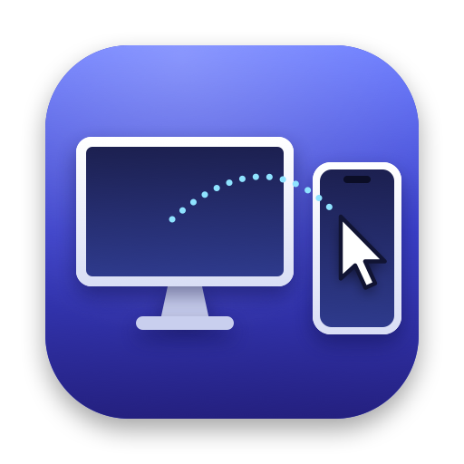
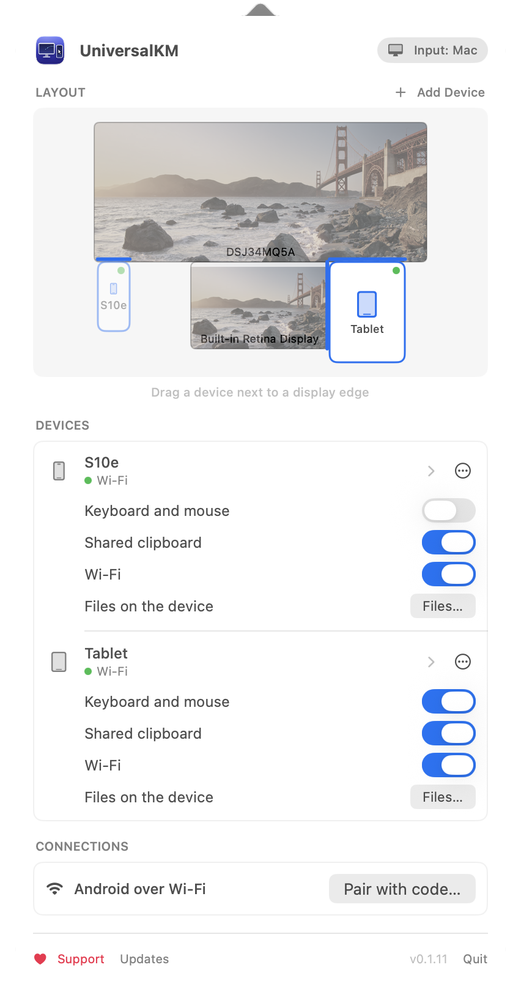
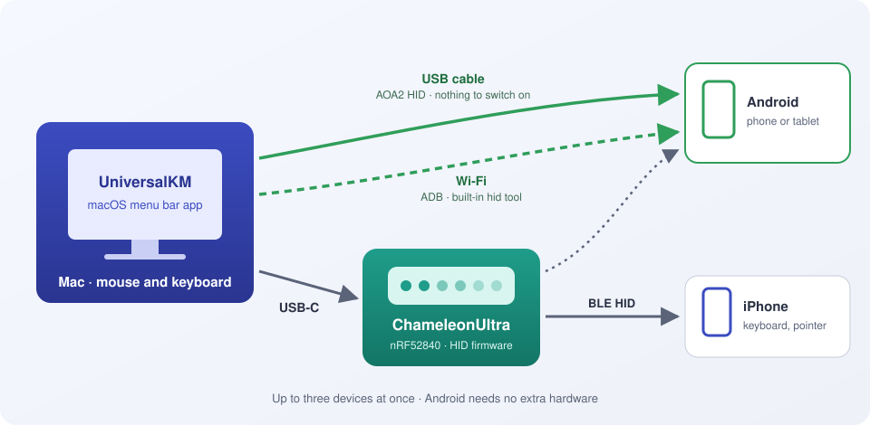
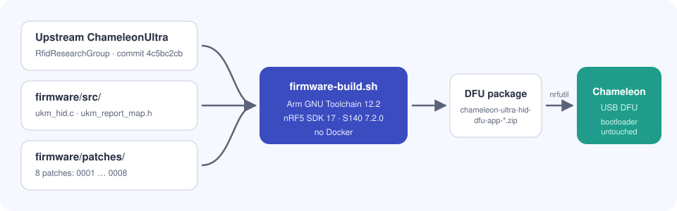

<p align="center">
  
</p>

<h1 align="center">UniversalKM</h1>

<p align="center"><b>English</b> · <a href="README.ru.md">Русский</a></p>

<p align="center">
  <b>Your Mac's mouse and keyboard for any phone or tablet.</b><br>
  Push the cursor against a screen edge and input moves to Android, iPad or iPhone, like Universal Control, but not limited to Apple devices. Android needs nothing but a cable or Wi‑Fi.
</p>

<p align="center">
  <a href="https://github.com/DeMoZ/UniversalKM/releases/latest"></a>
  
  
  
  
</p>

<p align="center">
  
</p>

---

## Features

| | |
|---|---|
| 🖱️ **Cross at an edge** | Place a phone or tablet next to any edge of any display. When the cursor hits that edge, it moves to the device together with the keyboard. |
| ↩️ **Come back the same way** | Move the cursor to the device edge that faces the Mac and keep pushing: input returns to the Mac at the same height. ⌃⌥⌘⎋ always works too. |
| 👻 **The Mac cursor stays out of the way** | While you control a device, the Mac cursor is hidden and does not move. |
| 📱 **Up to three devices** | Three devices connect at once, each with its own zone in the layout. |
| 📐 **True size** | Enter the device screen size in points and pixels, then drag a corner so the device matches its physical size next to your displays. |
| 🔌 **Android: cable or Wi‑Fi** | Plug an Android phone or tablet into the Mac, or connect it over Wi‑Fi. Nothing to buy and nothing to install on it. Unplug the cable and input carries on over Wi‑Fi. |
| 📡 **iPhone: ChameleonUltra** | A ChameleonUltra (or a similar Bluetooth board) acts as a Bluetooth keyboard and mouse for any device, an iPhone too. |
| 🔄 **Updates** | Updates install from the app (Sparkle, signed appcast). macOS permissions survive updates. |
| 🌍 **Your language** | The interface follows the system language: English, Russian, German, French, Spanish, Portuguese (Brazil), Italian, Chinese (Simplified), Japanese, Korean. |

## How it works

<p align="center">
  
</p>

UniversalKM lives in the menu bar. It captures the mouse and keyboard when the cursor enters a device's zone and sends key presses and motion to that device in one of three ways:

| Way | Devices | What you need | Delay |
|---|---|---|---|
| **USB cable** | Android | A cable that carries data. Nothing to switch on. | ≈ 1 ms |
| **Wi‑Fi (ADB)** | Android | Developer options on the phone, `adb` on the Mac | ≈ 5 ms¹ |
| **ChameleonUltra** or a similar board | Android, iPhone | The board on USB with the UniversalKM firmware | 15–30 ms |

The device always sees an ordinary keyboard and mouse: nothing is installed on it. The cable and Wi‑Fi come first because they need no extra hardware. One phone can use both, and the app moves between them by itself.

¹ Half of the adb round trip, 8 ms median on a home network (Samsung Galaxy S10e).

## Install

1. Download `UniversalKM-<version>.zip` from the [latest release](https://github.com/DeMoZ/UniversalKM/releases/latest) and move the app to Applications. First launch: right-click → Open.
2. Grant Accessibility access.
3. Connect a device:
   - **Android over a cable:** plug it in and press "Add…" next to it in the panel ([Android over USB](#android-over-usb)).
   - **Android over Wi‑Fi:** see [Android over Wi-Fi (ADB)](#android-over-wi-fi-adb).
   - **iPhone, or Android without developer options:** flash a ChameleonUltra with `chameleon-ultra-hid-dfu-app-<version>.zip` from the same release and pair the device with it ([iPhone: ChameleonUltra and similar boards](#iphone-chameleonultra-and-similar-boards)). The app asks for Bluetooth access.
4. Drag the device next to a display edge in the layout.

**Requirements:** macOS 14 or later, Apple Silicon. Building needs Xcode 27 and Swift 6.

## Android over USB

The Mac becomes an ordinary wired keyboard and mouse for the phone through the Android Open Accessory 2 protocol (AOA2 HID), the mechanism `scrcpy --otg` uses too. USB debugging is not needed, and nothing is installed on the phone.

1. Connect the phone or tablet with a cable that carries data (with a charge-only cable nothing shows up).
2. The panel lists it with an "Add…" button. Until you add it, the app leaves the phone alone: a phone plugged in just to charge keeps its on-screen keyboard.
3. Press "Add…", then drag the device next to a display edge.

- The phone is known by its serial number, so it keeps its place after unplugging, after a restart and in any USB mode (file transfer, charging only, tethering, photo transfer).
- Unplugging the cable returns input to the Mac, unless the phone is also on Wi‑Fi: then work carries on over Wi‑Fi.
- Quitting the app removes the keyboard and mouse from the phone, and its on-screen keyboard comes back.
- It needs AOA 2, which practically every phone since Android 4.1 has. Some vendors leave AOA out; such a device is skipped, and Wi‑Fi or the Chameleon still work.
- Tested on a Samsung Galaxy S10e (Android 12).

How it works on the Mac: AOA is a handful of vendor control requests to the device on endpoint 0. IOKit lets any app send those without claiming an interface, so the app needs no libusb, no root and no special entitlement.

## Android over Wi-Fi (ADB)

Without a cable the app drives the phone over ADB: Android's built-in `hid` tool (`/system/bin/hid`) creates a virtual keyboard and mouse on the phone through UHID. No root and no app on the phone, but it needs developer options on the phone and `adb` on the Mac.

1. Install adb: `brew install android-platform-tools` (or Android Studio). The app finds it in `/opt/homebrew/bin`, `/usr/local/bin` and `~/Library/Android/sdk/platform-tools`; without it the panel shows how to install it.
2. On the phone, unlock developer options: Settings → About phone → tap "Build number" seven times.
3. Connect the phone one of two ways:
   - **Wireless debugging (Android 11 and later):** Developer options → Wireless debugging → "Pair device with pairing code" (not the QR code). In the panel press "Pair with code…" and enter the IP address with port and the six-digit code from that screen. From then on the app finds the phone on the network by itself whenever wireless debugging is on.
   - **Through the cable (any Android):** turn on USB debugging, plug the phone in, allow the Mac on the phone, and press "Enable Wi‑Fi" next to it in the panel. The phone stays reachable over Wi‑Fi until it restarts; after a restart, plug it in and press "Enable Wi‑Fi" again.
4. Add the device in the panel ("Add…") and place it next to a display edge.

- A phone on both the cable and Wi‑Fi uses the cable. Unplugging it switches to Wi‑Fi in under a second without returning the cursor to the Mac; plugging it back in switches back.
- If the phone leaves the network, input returns to the Mac within about 3 seconds. When it is back, the app reconnects by itself.
- Delay: the adb round trip over Wi‑Fi was 8 ms median (12 ms at the 90th percentile, rare spikes of 100 ms) on a home network. The cable is faster.
- With developer options and wireless debugging on, every computer you allowed can control the phone. Turn wireless debugging on only on networks you trust; Android turns it off when you change networks.

## iPhone: ChameleonUltra and similar boards

iOS accepts no keyboard from a USB host and has no ADB, so an iPhone (or an Android phone without developer options) needs a Bluetooth keyboard the Mac can drive. That is a separate board on USB; this project uses a ChameleonUltra. The UniversalKM firmware turns it into an ordinary Bluetooth keyboard and mouse (BLE HID), and the device pairs with it like with any Bluetooth keyboard.

An iPad works the same way, but with the same Apple ID on both, Apple's Universal Control already does this without extra hardware.

### Why not the Mac's built-in Bluetooth

The obvious approach is for the Mac itself to pose as a Bluetooth keyboard. macOS does not allow it:

- **BLE.** `CBPeripheralManager` refuses to publish the HID service `0x1812`, as well as Device Information `0x180A` and Battery `0x180F`, with *"The specified UUID is not allowed for this operation"*. Without these services a phone will not accept the device as a keyboard.
- **Classic Bluetooth.** IOBluetooth has no supported API for the HID device role: a Mac can connect keyboards but cannot be one.
- **Universal Control** only works between a Mac and an iPad signed in to the same Apple ID.

#### A plain USB Bluetooth dongle does not help either

Plugging in a second Bluetooth adapter and driving it directly sounds simple. On macOS it does not work:

- macOS only uses its own Bluetooth controller and has no drivers for third-party USB adapters;
- claiming a USB interface of a device from your own program requires the restricted entitlement `com.apple.vm.device-access`, so libusb is refused even as root (plain control requests to a device, which Android over USB uses, need no claim);
- cheap "Wi‑Fi + Bluetooth" adapters such as the AIC8800 show up as a Windows driver disk.

This was checked with an AIC 88M80 adapter: it never switched into Bluetooth mode.

#### What does work

You need a separate microcontroller with Bluetooth LE that acts as an HID keyboard by itself and talks to the Mac over a USB port:

| Device | Chip | Notes |
|---|---|---|
| **ChameleonUltra** | nRF52840 | ✅ Used by UniversalKM. Keeps its NFC/RFID functions. |
| Nordic nRF52840 Dongle (PCA10059), Seeed XIAO nRF52840, Adafruit Feather nRF52840 | nRF52840 | Same chip as the Chameleon. Needs its own HID firmware. |
| ESP32‑S3 / ESP32‑C3 (any board with USB) | ESP32 | The cheapest option: BLE HID with NimBLE, USB serial to the Mac. |
| Raspberry Pi Pico W / Pico 2 W | RP2040 / RP2350 + CYW43439 | BLE HID with BTstack. |

Of these boards, the app supports only the ChameleonUltra for now. The transport is behind the `HIDTransport` protocol, so another board can be added with its own firmware and transport.

### The device used here: ChameleonUltra

[ChameleonUltra](https://github.com/RfidResearchGroup/ChameleonUltra) by RfidResearchGroup is an open-source, keyfob-sized NFC/RFID card emulator and reader. Inside is a **Nordic nRF52840**: a Cortex‑M4F with Bluetooth 5, everything a BLE keyboard needs. It was already at hand, so there was no need to buy an ESP32.

| | |
|---|---|
| **Model** | ChameleonUltra, hw v1, USB `6868:8686` |
| **Factory firmware** | v2.1.0 (you can roll back to it) |
| **UniversalKM firmware base** | upstream [`4c5bc2cb`](https://github.com/RfidResearchGroup/ChameleonUltra/commit/4c5bc2cb6b023d23f7bbc383c9b2b5e39f95419e) (v2.3.0‑14), nRF5 SDK 17, SoftDevice S140 7.2.0 |
| **Flashed with** | `nrfutil` over USB through the Chameleon's stock DFU bootloader. The bootloader is never changed. |
| **Built with** | Arm GNU Toolchain 12.2 and `make`, no Docker (`scripts/firmware-build.sh`) |

#### What the firmware adds

<p align="center">
  
</p>

The project's own code is in `firmware/src/` (`ukm_hid.c`, `ukm_report_map.h`). Changes to upstream are eight small patches in `firmware/patches/`:

| Patch | What it does |
|---|---|
| `0001` Makefile | adds the HID sources and the SDK modules `ble_hids`, `ble_dis` |
| `0002` sdk_config | enables HID and Device Information, 3 simultaneous links, a larger GATT table |
| `0003` ble_main | HID services, advertising as `ChameleonUltra`, pairing without a code, a separate control link for the Mac |
| `0004` app_cmd | USB commands 9000–9006: turn the mode on, send keyboard or mouse reports to a given device, device list, counters |
| `0005` usb_main | when USB is unplugged: release all keys, and turn the mode off if the Mac has no Bluetooth link |
| `0006` application.ld | moves RAM to make room for a SoftDevice with three links |
| `0007` app_main | LESC handler when the PIN is off |
| `0008` peer_manager | pairing events that upstream dropped when the PIN is off |

HID reports: keyboard (ID 1, 8 bytes, plus LEDs) and mouse (ID 2, buttons, 16‑bit X/Y, wheel and horizontal scroll). Cards, slots, buttons and the stock Chameleon client keep working. The keyboard and mouse mode is turned on only by the app.

### ChameleonUltra: build and flash

```bash
scripts/firmware-build.sh       # build/ultra-dfu-app.zip
scripts/firmware-flash.sh       # flash over USB (stock DFU)
```

- **Build.** The script installs Arm GNU Toolchain 12.2 and `nrfutil` into `~/Library/Caches/UniversalKM-firmware-tools`, downloads the upstream firmware into `build/firmware-src/`, copies `firmware/src/` there and applies `firmware/patches/`.
- **Flash.** Quit the stock Chameleon client and UniversalKM: only one program can hold the port. The script puts the Chameleon into DFU by itself. If that fails, switch the Chameleon off, hold button B and plug in USB (LEDs 4 and 5 blink); the script waits.
- **Roll back to the official firmware:** `scripts/firmware-flash.sh --official` (the default version is `OFFICIAL_TAG` in `firmware/UPSTREAM`) or `scripts/firmware-flash.sh --official v2.3.0`.

### Pairing a phone or tablet

While UniversalKM runs, the Chameleon advertises itself as a Bluetooth keyboard named `ChameleonUltra`. Up to three devices connect at once. Reports go to the device that has the input.

- **Android:** Settings → Bluetooth → Pair new device → `ChameleonUltra`. Pointer and keyboard work right away.
- **iPhone / iPad:** Settings → Bluetooth → `ChameleonUltra`. The keyboard works right away. iOS shows a mouse pointer only with AssistiveTouch on (Accessibility → Touch → AssistiveTouch). On iPhone the pointer does not move yet: a known issue, task 1.16.
- **PIN.** If PIN pairing is on in the Chameleon settings, the phone asks for it; if it is off (the default), pairing needs no code. Switch it with the stock Chameleon client: `hw settings blepair -e` / `-d`; set the PIN with `hw settings blekey`.
- **Do not pair the Mac itself** with the Chameleon in Bluetooth settings. The Mac takes one of the three links and starts receiving the key presses. If you already did, choose "Forget This Device".
- **Pairing is remembered:** after the app or the Chameleon restarts, devices reconnect by themselves. To remove a pairing: "Forget device" on the phone, `hw settings bleclearbonds` on the Chameleon.
- **When the app is closed,** the Chameleon disconnects the devices and stops advertising until the next launch, and the phone's on-screen keyboard comes back.

### USB and Bluetooth between the Mac and the Chameleon

The app finds the Chameleon over USB by itself and keeps a Bluetooth connection to it at the same time (the stock Nordic UART link; this is not macOS pairing).

- If USB is unplugged, work continues over Bluetooth. When USB comes back, the app switches back to it.
- While the Mac is connected over Bluetooth, it takes one of the Chameleon's three links, leaving two for devices.
- If USB is unplugged and the Mac has no Bluetooth link, the Chameleon turns the keyboard and mouse mode off, releases all keys and disconnects the devices.

On first launch macOS asks for Bluetooth access; allow it. `Resources/Info.plist` keys: `LSUIElement` (menu bar only), `NSBluetoothAlwaysUsageDescription` (Bluetooth link to the Chameleon), `SUFeedURL` and `SUPublicEDKey` (updates).

## Building the app

```bash
scripts/build-app.sh          # build/UniversalKM.app
scripts/build-app.sh --zip    # + build/UniversalKM-<version>.zip
scripts/run.sh                # build, relaunch and follow the log
scripts/run.sh --ble-demo     # demo: a square drawn with the pointer, a click and "hello" on each device
```

**Signing.** macOS ties the Accessibility and Input Monitoring permissions to the signing certificate. The script picks a certificate in this order:

1. `SIGN_IDENTITY`, if set;
2. the first "Apple Development" identity;
3. the project's self-signed certificate "UniversalKM Self-Signed" from the keychain;
4. with no certificate, an ad-hoc signature.

With a stable certificate, permissions survive rebuilds and updates; with ad-hoc signing they reset every time.

- **The project certificate** is in the login keychain (key and certificate "UniversalKM Self-Signed", valid 10 years) and in the repository secrets `SIGNING_CERTIFICATE_P12` / `SIGNING_CERTIFICATE_PASSWORD`, which sign releases. Back it up: Keychain Access → My Certificates → "UniversalKM Self-Signed" → Export… (.p12 with a password), and keep it in a password manager. If the certificate is lost, the next update asks for permissions once more.
- A self-signed certificate does not remove the macOS warning on first launch. Only an Apple Developer ID certificate with notarization does.

## Updates and releases

The app checks for updates once a day; the "Updates" button at the bottom of the panel checks right away. Updates are installed by [Sparkle](https://sparkle-project.org): it reads `appcast.xml` from the latest GitHub release and installs only archives signed with the project key (EdDSA).

- **Signing key.** The private half is in the keychain (account `UniversalKM`) and in the repository secret `SPARKLE_PRIVATE_KEY`; the public half is `SUPublicEDKey` in `Resources/Info.plist`. If the key is lost, installed copies cannot update. Back it up to a password manager, then delete the file:
  ```bash
  .build/artifacts/sparkle/Sparkle/bin/generate_keys --account UniversalKM -x ~/universalkm-sparkle.key
  ```
- **Releasing a version.** Bump `CFBundleShortVersionString` and `CFBundleVersion` in `Resources/Info.plist`, write `docs/releases/v<version>.md`, merge into `main` and push a tag:
  ```bash
  git tag v0.1.0 && git push origin v0.1.0
  ```
  The `.github/workflows/release.yml` workflow checks that the tag matches the version, runs the tests, builds the app and the Chameleon firmware, signs the appcast and publishes a release with `UniversalKM-<version>.zip`, `appcast.xml` and `chameleon-ultra-hid-dfu-app-<version>.zip`.
- **Locally, without publishing:** `scripts/build-app.sh --zip && scripts/appcast.sh build/UniversalKM-<version>.zip`. The key is taken from the keychain.

## Support the project

UniversalKM is free. The "♥ Support" button at the bottom of the panel shows ways to support it. They are loaded from [DeMoZ/donations](https://github.com/DeMoZ/donations) (`universalkm.json`), so the links change without a new release.

> Plan and requirements: `openspec/changes/add-ble-hid-input-bridge/`; Android over USB and Wi‑Fi: `openspec/changes/add-android-usb-transport/`.
