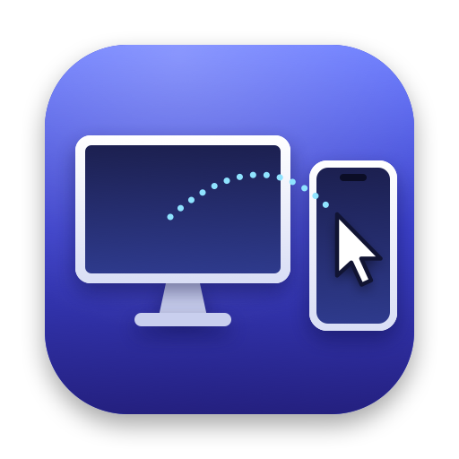
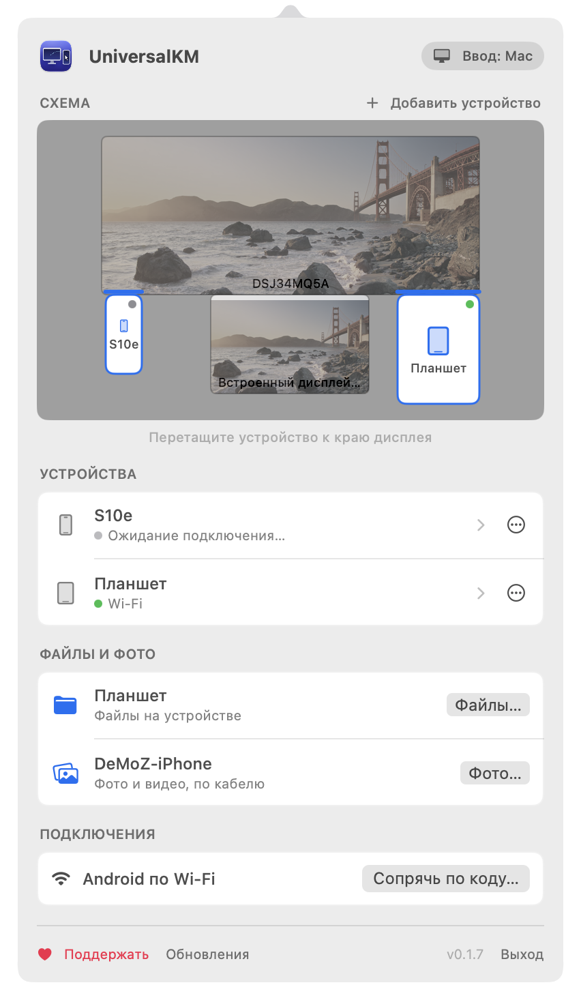
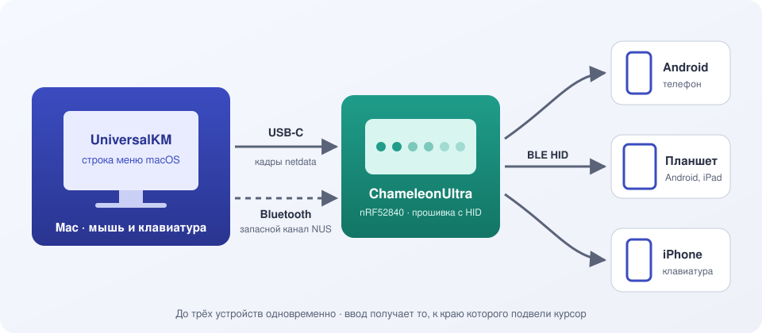
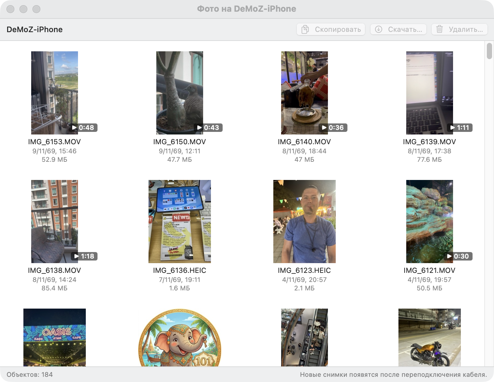
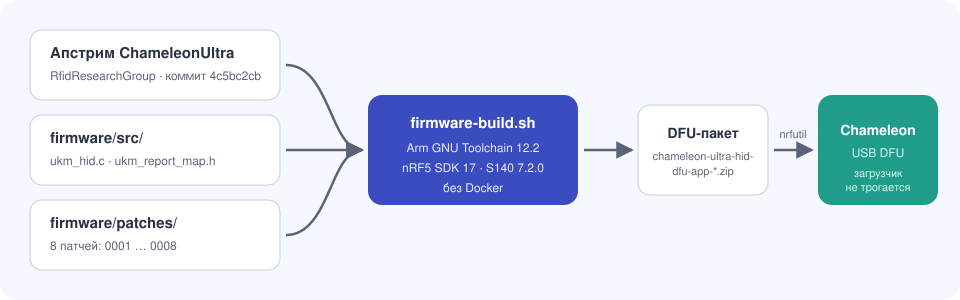

<p align="center">
  
</p>

<h1 align="center">UniversalKM</h1>

<p align="center"><a href="README.md">English</a> · <b>Русский</b></p>

<p align="center">
  <b>Мышь и клавиатура Mac для любого телефона и планшета.</b><br>
  Подведите курсор к краю экрана, и ввод перейдёт на Android, iPad или iPhone, как в Universal Control, только не только для техники Apple. Для Android хватит кабеля или Wi‑Fi.<br>
  А ещё файлы: память Android и фото iPhone прямо в Finder.
</p>

<p align="center">
  <a href="https://github.com/DeMoZ/UniversalKM/releases/latest"></a>
  
  
  
  
</p>

<p align="center">
  
</p>

---

## Что умеет

| | |
|---|---|
| 🖱️ **Переход по краю** | Телефон или планшет ставится на схеме к краю любого дисплея. Курсор, упёршийся в этот край, уходит на устройство вместе с клавиатурой. |
| ↩️ **Возврат так же** | Доведите курсор до края устройства, обращённого к Mac, и толкните дальше: ввод вернётся на Mac на той же высоте. ⌃⌥⌘⎋ возвращает всегда. |
| 👻 **Курсор Mac не мешает** | Пока вы управляете устройством, курсор Mac скрыт и стоит на месте. |
| 📱 **До трёх устройств** | Одновременно подключаются три устройства, у каждого своя зона на схеме. |
| 📐 **Реальный размер** | У устройства задаётся размер экрана в точках и пикселях, а прямоугольник тянется за уголок, чтобы на схеме совпал физический размер. |
| 🔌 **Android: кабель или Wi‑Fi** | Android‑телефон или планшет подключается к Mac кабелем или по Wi‑Fi. Ничего не нужно покупать и ничего не ставится на него. Если выдернуть кабель, ввод продолжится по Wi‑Fi. |
| 📋 **Общий буфер обмена с Android** | Текст, скопированный на Mac, вставляется на Android‑устройстве, и наоборот. Работает через adb (отладка по USB или по Wi‑Fi). |
| 📂 **Файлы Android** | Окно с памятью телефона: фото и файлы перетаскиваются в Finder и обратно, по Wi‑Fi или по кабелю с отладкой. |
| 🖼️ **Фото iPhone** | Окно с фото и видео iPhone на кабеле: скопировать на Mac, удалить с iPhone. |
| 🎥 **Камера движения** | Android-телефон или планшет пишет видео, пока перед ним что-то движется, и хранит ролики; работает без Mac. Смотреть — с Mac. |
| 📡 **iPhone: ChameleonUltra** | ChameleonUltra (или похожая Bluetooth‑плата) работает Bluetooth‑клавиатурой и мышью для любого устройства, в том числе iPhone. |
| 🔄 **Обновления** | Обновления ставятся из приложения (Sparkle, подписанная лента). Разрешения macOS после обновления не сбрасываются. |
| 🌍 **Язык системы** | Интерфейс на языке системы: русский, английский, немецкий, французский, испанский, португальский (Бразилия), итальянский, китайский (упрощённый), японский, корейский. |

### Что можно с iPhone

- **Скопировать фото и видео на Mac** по кабелю: «Скачать…» в папку или ⌘C в окне и ⌘V в Finder. Файлы остаются в формате iPhone (HEIC, MOV) и с датой съёмки, Live Photo приходит парой: фото и его видео. Около 35 МБ/с. [Подробнее](#фото-iphone)
- **Удалить фото и видео с iPhone** после копирования, с подтверждением. Live Photo удаляется вместе со своим видео, всё попадает в «Недавно удалённые» на iPhone.
- **Печатать на iPhone клавиатурой Mac** через ChameleonUltra на USB: iPhone видит её как Bluetooth‑клавиатуру. Курсор мыши на iPhone пока не двигается. [Подробнее](#iphone-chameleonultra-и-похожие-платы)

## Как это устроено

<p align="center">
  
</p>

UniversalKM живёт в строке меню. Он перехватывает мышь и клавиатуру, когда курсор входит в зону устройства, и отправляет нажатия и движения этому устройству одним из трёх способов:

| Способ | Устройства | Что нужно | Задержка |
|---|---|---|---|
| **USB‑кабель** | Android | Кабель с передачей данных. Ничего включать не нужно. | ≈ 1 мс |
| **Wi‑Fi (ADB)** | Android | Режим разработчика на телефоне, `adb` на Mac | ≈ 5 мс¹ |
| **ChameleonUltra** или похожая плата | Android, iPhone | Плата на USB с прошивкой UniversalKM | 15–30 мс |

Устройство всегда видит обычную клавиатуру и мышь: на него ничего не ставится. Кабель и Wi‑Fi идут первыми, потому что не требуют дополнительного железа. Один телефон может работать и так, и так, а приложение само переходит между ними.

¹ Половина времени ADB «туда и обратно»: медиана 8 мс в домашней сети (Samsung Galaxy S10e).

## Установка

1. Скачайте `UniversalKM-<версия>.zip` из [последнего релиза](https://github.com/DeMoZ/UniversalKM/releases/latest) и перенесите приложение в «Программы». Первый запуск: правый клик → «Открыть».
2. Дайте разрешение «Универсальный доступ».
3. Подключите устройство:
   - **Android по кабелю:** подключите его и нажмите «Добавить…» рядом с ним в панели ([Android по проводу](#android-по-проводу)).
   - **Android по Wi‑Fi:** см. [Android по Wi-Fi (ADB)](#android-по-wi-fi-adb).
   - **iPhone или Android без режима разработчика:** прошейте ChameleonUltra пакетом `chameleon-ultra-hid-dfu-app-<версия>.zip` из того же релиза и сопрягите устройство с ним ([iPhone: ChameleonUltra и похожие платы](#iphone-chameleonultra-и-похожие-платы)). Приложение попросит доступ к Bluetooth.
4. Поставьте устройство на схеме к нужному краю дисплея.

**Требования:** macOS 14 или новее, Apple Silicon. Для сборки нужны Xcode 27 и Swift 6.

## Android по проводу

Mac становится для телефона обычной проводной клавиатурой и мышью по протоколу Android Open Accessory 2 (AOA2 HID), так же работает `scrcpy --otg`. Отладка по USB не нужна, на телефон ничего не ставится.

1. Подключите телефон или планшет кабелем с передачей данных (с кабелем только для зарядки ничего не появится).
2. Панель покажет его с кнопкой «Добавить…». Пока вы его не добавили, приложение телефон не трогает: если он просто заряжается, экранная клавиатура остаётся на месте.
3. Нажмите «Добавить…» и поставьте устройство к краю дисплея.

- Телефон узнаётся по серийному номеру, поэтому сохраняет своё место после отключения, перезапуска и в любом режиме USB (передача файлов, только зарядка, USB‑модем, передача изображений).
- Если выдернуть кабель, ввод вернётся на Mac, а если телефон подключён ещё и по Wi‑Fi, работа продолжится по Wi‑Fi.
- При выходе из приложения клавиатура и мышь с телефона снимаются, и экранная клавиатура возвращается.
- Переключатель **«Клавиатура и мышь»** в строке устройства включает и выключает управление им, не убирая его со схемы. Когда выключено, курсор на устройство не переходит, клавиатура и мышь с телефона снимаются (экранная клавиатура возвращается), а место, настройки, файлы и буфер обмена остаются. Если включить его снова, управление вернётся. По Wi‑Fi работает так же; у устройства через ChameleonUltra связь Bluetooth остаётся, только курсор на него не переходит.
- Нужен AOA 2, он есть практически у всех телефонов с Android 4.1. Некоторые производители AOA вырезают: такое устройство пропускается, а Wi‑Fi и Chameleon продолжают работать.
- Проверено на Samsung Galaxy S10e (Android 12).

Как это работает на Mac: AOA — это несколько vendor‑запросов к устройству по нулевой конечной точке. IOKit разрешает их любому приложению без захвата интерфейса, поэтому не нужны ни libusb, ни root, ни особые entitlement.

## Android по Wi-Fi (ADB)

Без кабеля приложение управляет телефоном через ADB: встроенная в Android утилита `hid` (`/system/bin/hid`) создаёт на телефоне виртуальную клавиатуру и мышь через UHID. Root и приложение на телефоне не нужны, но нужен режим разработчика на телефоне и программа `adb` на Mac.

1. Установите adb: `brew install android-platform-tools` (или Android Studio). Приложение находит его в `/opt/homebrew/bin`, `/usr/local/bin` и `~/Library/Android/sdk/platform-tools`; если его нет, панель подскажет, как установить.
2. На телефоне включите режим разработчика: Настройки → Сведения о телефоне → семь раз нажмите «Номер сборки».
3. Подключите телефон одним из двух способов:
   - **«Отладка по Wi‑Fi» (Android 11 и новее):** Параметры разработчика → Отладка по Wi‑Fi → «Подключить устройство с кодом подключения» (не QR‑код). В панели нажмите «Сопрячь по коду…» и введите IP‑адрес с портом и шестизначный код из этого окна. Дальше приложение само находит телефон в сети, пока на нём включена отладка по Wi‑Fi.
   - **Через кабель (любой Android):** включите отладку по USB, подключите телефон, разрешите на нём этот Mac и нажмите «Включить Wi‑Fi» рядом с ним в панели. Телефон доступен по Wi‑Fi до перезагрузки; после неё подключите кабель и снова нажмите «Включить Wi‑Fi».
4. Добавьте устройство в панели («Добавить…») и поставьте его к краю дисплея.

- Если телефон подключён и кабелем, и по Wi‑Fi, работает кабель. Если его выдернуть, приложение меньше чем за секунду переходит на Wi‑Fi, и курсор на Mac не возвращается; если вставить обратно, переходит назад.
- Если телефон пропал из сети, ввод возвращается на Mac примерно за 3 секунды. Когда телефон снова в сети, приложение подключается само.
- Задержка: ADB «туда и обратно» по Wi‑Fi в домашней сети — медиана 8 мс (12 мс у 90 % пакетов, редкие всплески до 100 мс). Кабель быстрее.
- **macOS один раз спросит, можно ли `adb` находить устройства в локальной сети: разрешите.** Приложение запускает сервер adb отдельным процессом, поэтому он работает и после выхода из приложения (иначе macOS отрезает ему сеть, как только UniversalKM закрывается, и `adb` в Терминале показывает телефон `offline`). Если отказали: Системные настройки → Конфиденциальность и безопасность → Локальная сеть → включите `adb`. Вопрос повторится один раз после обновления platform-tools, потому что путь к `adb` содержит версию.
- Пока включены режим разработчика и отладка по Wi‑Fi, телефоном может управлять любой компьютер, которому вы это разрешили. Включайте отладку по Wi‑Fi только в доверенной сети; Android сам выключает её при смене сети.

## Общий буфер обмена (Android)

Если у Android‑устройства из схемы есть связь adb (отладка по Wi‑Fi, как выше, или отладка по USB при подключении кабелем), буфер обмена у него и у Mac общий. Ставить на телефон ничего не нужно: приложение кладёт на него маленький помощник (`/data/local/tmp/ukm-clipboard-*.jar`, единицы КБ) и запускает его через `app_process` с правами отладки, как это делает scrcpy. При отключении телефона или выходе из приложения помощник завершается.

- **В обе стороны и сразу.** Скопировали на Mac, и текст уже в буфере телефона. Скопировали на телефоне, пальцем или клавиатурой Mac, и текст уже в буфере Mac. Обычно меньше чем за секунду.
- **Только текст**, до 1 МБ. Картинки, файлы и форматирование не передаются.
- **Пароли не уходят.** То, что менеджеры паролей помечают как скрытое (`org.nspasteboard.ConcealedType` и похожие пометки), остаётся на Mac. Любой другой текст передаётся, в том числе пароль, скопированный вручную из обычного окна.
- **Пока телефон заблокирован,** Android не показывает его буфер, но текст с Mac принимает: после разблокировки он на месте.
- **Только по кабелю без отладки по USB** (AOA) общего буфера нет: панель покажет «нужна отладка по USB или Wi‑Fi».
- **Android 13 и новее** показывает своё окошко «скопировано» каждый раз, когда текст приходит с Mac (видно на Android 16). Это окно системы, отключить его нельзя.
- **Выключить** можно у каждого устройства: переключатель «Общий буфер обмена» в строке устройства, под «Клавиатура и мышь».
- Текст буфера не пишется в журнал приложения, только его длина.

## Файлы Android

В панели, в разделе «Файлы и фото», нажмите «Файлы…» у Android‑устройства. Откроется окно с общей памятью устройства: DCIM, Download, Documents и остальные папки, которые видит приложение «Мои файлы». Кнопка есть, когда к устройству есть связь через `adb`: по Wi‑Fi (раздел выше) или по кабелю с включённой отладкой по USB. Устройство только на кабеле в режиме клавиатуры и мыши, без отладки, файлов не даёт.

- **С телефона на Mac:** перетащите файлы или папки из окна в Finder или на рабочий стол, или нажмите ⌘C в окне и ⌘V в Finder (окно сначала скачает файлы и напишет «Скопировано»), или нажмите «Скачать…» и выберите папку. Двойной щелчок по файлу открывает его на Mac (копия во временной папке; правки в ней на телефон не возвращаются).
- **С Mac на телефон:** перетащите файлы или папки из Finder в окно (на папку в списке — в эту папку), или скопируйте их в Finder и нажмите ⌘V в окне, или нажмите «Отправить…». Если такое имя уже есть, окно спросит, заменить или пропустить.
- **На телефоне:** новая папка (⇧⌘N), переименование (Return), удаление (Delete). **Удаление стирает файлы с телефона сразу, без корзины.**
- Ход переноса виден внизу окна, любой перенос можно отменить. Отменённый или оборванный перенос не оставляет недокачанного файла под настоящим именем ни на Mac, ни на телефоне.
- Список обновляется сам раз в 10 секунд и по ⌘R. Скрытые файлы (с точки в начале имени) не показываются, как в Finder.
- Если связь пропала, окно пишет «Устройство не подключено» и само открывает папку снова, когда телефон вернётся по Wi‑Fi или по кабелю.
- Скорость: по Wi‑Fi в домашней сети 11–17 МБ/с (проверено на Galaxy S10e и Galaxy Tab A9), по кабелю с отладкой быстрее. Если есть и кабель, и Wi‑Fi, файлы идут по кабелю. Видео на несколько гигабайт по Wi‑Fi копируется минутами.
- Файлы доступны, пока запущен UniversalKM. Место телефона в боковой панели Finder не появляется: для этого macOS требует сертификат Apple Developer ID.

## Камера движения на Android

Старый Android-телефон или планшет может присматривать за комнатой: он пишет видео, пока перед камерой что-то движется, и останавливается, когда картинка снова спокойна. Работает сам, без Mac: Mac может спать или быть далеко.

1. Подключите устройство через `adb` (Wi‑Fi или кабель с отладкой по USB, как для файлов).
2. В панели, в разделе «Камера движения», нажмите «Камера движения…» у устройства: откроется окно камеры (своё для каждого устройства, чтобы панель не разрасталась). Нажмите «Установить камеру…». UniversalKM поставит на устройство по `adb` своё небольшое приложение **UniversalKM Motion** и выдаст ему доступ к камере и уведомлениям, запуск после перезагрузки и работу без ограничения батареи. Некоторые телефоны (Xiaomi, часть Samsung) сначала просят подтвердить установку на экране.
3. Включите «Записывать при движении». Выключение — в окне или на устройстве (в приложении UniversalKM Motion или кнопкой «Выключить» в его уведомлении) — останавливает запись, пока её снова не включат с любой стороны; после перезагрузки устройства она остаётся выключенной. Пока камера включена, на устройстве горит индикатор камеры и висит уведомление; Android не даёт приложению их скрыть. Экран можно выключить.

- **Как пишет:** ролик начинается за 3 секунды до движения и заканчивается, когда ничего не движется дольше «Остановки» (по умолчанию 10 секунд). Ролик не длиннее 10 минут; долгое движение продолжается в следующем файле без пропуска. Включённый в комнате свет — не движение. Звук не пишется.
- **Куда:** `Movies/UniversalKM Motion/` на устройстве, имя — время начала (`2026-11-10_14-32-05.mp4`). «Записи…» в окне камеры открывает эту папку в окне файлов; двойной щелчок по ролику — посмотреть на Mac. Ролики видны и в галерее устройства.
- **Камера:** задняя, передняя или обе. «Обе» работает там, где Android сообщает, что устройство умеет снимать двумя камерами сразу; тогда каждая камера пишет свои ролики (`… rear.mp4`, `… front.mp4`) в 720p. Иначе «Обе» недоступно (например, Galaxy Tab A9 так не умеет).
- **Настройки** (в окне камеры): чувствительность, сколько ждать перед остановкой, 720p или 1080p и сколько места могут занять ролики (по умолчанию 4 ГБ: самые старые удаляются, чтобы не выйти за предел). Файлы, которые вы сами положили в эту папку, не удаляются никогда.
- **Сама по себе:** после перезагрузки устройства камера включается снова (после первой разблокировки). Если Android не даёт ей включиться самой, устройство показывает «Нажмите, чтобы включить снова». Ниже 10 % батареи без зарядки камера останавливается и включается снова, когда подключат зарядку; держите устройство на зарядке. Если свободно меньше 500 МБ, новые ролики не начинаются.
- **Приватность:** у приложения нет доступа в интернет, оно ничего никуда не отправляет. Ролики попадают на Mac, только когда вы их открываете или скачиваете. Другие приложения на устройстве не могут включить камеру или прочитать её состояние — только `adb`.
- Samsung и некоторые другие телефоны всё равно сами останавливают фоновые приложения. Если камера выключается сама, поставьте для UniversalKM Motion в настройках приложения на устройстве расход батареи «Без ограничений».
- Удалить: как любое приложение на устройстве (ролики останутся в Movies).

## Фото iPhone

<p align="center">
  
</p>

Подключите iPhone или iPad к Mac кабелем и разблокируйте его, затем в панели, в разделе «Файлы и фото», нажмите «Фото…» у iPhone. Строка видна, пока iPhone на кабеле, даже если его нет на схеме. Если iPhone спросит, нажмите «Доверять». Откроется окно с фото и видео iPhone, новые сверху. У видео видна длительность, у Live Photo — значок LIVE.

- **Только кабель:** фото читаются по USB через тот же системный механизм, что у «Захвата изображений». По Bluetooth (Chameleon) и по Wi‑Fi их не видно.
- **На Mac:** перетащите снимки из окна в Finder или на рабочий стол, или нажмите ⌘C в окне и ⌘V в Finder (окно сначала скачает файлы и напишет «Скопировано»), или нажмите «Скачать…» и выберите папку. Файлы копируются как есть, в формате iPhone (HEIC, MOV, JPG), с датой съёмки. Live Photo копируется парой: фото и его короткое видео с тем же именем.
- **Удаление с iPhone:** Delete, «Удалить…» или контекстное меню, с подтверждением. Снимок пропадает из «Фото» на iPhone (Live Photo — вместе с видео). Проверьте «Недавно удалённые» на iPhone, если хотите вернуть снимок.
- **Новые снимки** iPhone показывает после переподключения кабеля: список iPhone составляет при подключении, так же и в «Захвате изображений».
- **Если включены «Фото iCloud» с оптимизацией хранилища,** видно только то, что лежит на самом iPhone. Если iPhone не даёт удалять, кнопка «Удалить…» недоступна.
- Пока окно открыто, iPhone занят им: «Фото» и «Захват изображений» на Mac могут его не видеть. Закройте окно, и они снова его увидят.
- Скорость по кабелю около 35 МБ/с (видео 50 МБ — за 1,5 с).
- Отправить фото на iPhone этим окном нельзя.

## iPhone: ChameleonUltra и похожие платы

iOS не принимает клавиатуру от USB‑хоста и не даёт ADB, поэтому для iPhone (и для Android без режима разработчика) Mac нужна Bluetooth‑клавиатура, которой он может управлять. Это отдельная плата на USB; в этом проекте — ChameleonUltra. Прошивка UniversalKM превращает его в обычную Bluetooth‑клавиатуру и мышь (BLE HID), и устройство сопрягается с ним, как с любой Bluetooth‑клавиатурой.

iPad работает так же, но при одном Apple ID на Mac и iPad то же самое без дополнительного железа делает «Универсальное управление» Apple.

### Почему не встроенный Bluetooth Mac

Логично было бы, чтобы Mac сам притворился Bluetooth‑клавиатурой. macOS этого не позволяет:

- **BLE.** `CBPeripheralManager` отказывается публиковать сервис HID `0x1812`, а также Device Information `0x180A` и Battery `0x180F`, с ошибкой *«The specified UUID is not allowed for this operation»*. Без этих сервисов телефон не примет устройство как клавиатуру.
- **Классический Bluetooth.** В IOBluetooth нет поддерживаемого API для роли HID‑устройства: Mac может подключать клавиатуры, но не быть ею.
- **Universal Control** работает только между Mac и iPad Apple ID одного владельца.

#### Обычный USB‑донгл тоже не поможет

Кажется, что достаточно воткнуть второй Bluetooth‑адаптер и управлять им напрямую. На macOS так не выйдет:

- macOS работает только со своим Bluetooth‑контроллером, драйверов для сторонних USB‑адаптеров нет;
- захватить интерфейс USB‑устройства из своей программы мешает ограниченный entitlement `com.apple.vm.device-access`: libusb получает отказ даже от root (простым управляющим запросам к устройству, на которых работает Android по USB, захват не нужен);
- дешёвые адаптеры «Wi‑Fi + Bluetooth» вроде AIC8800 вообще видны как диск с драйверами для Windows.

Это проверено на адаптере AIC 88M80: в режим Bluetooth он не переключился.

#### Что подходит

Нужен отдельный микроконтроллер с Bluetooth LE, который сам ведёт себя как HID‑клавиатура, а с Mac общается по USB‑порту:

| Устройство | Чип | Комментарий |
|---|---|---|
| **ChameleonUltra** | nRF52840 | ✅ Используется в UniversalKM. Свои функции NFC/RFID сохраняет. |
| Nordic nRF52840 Dongle (PCA10059), Seeed XIAO nRF52840, Adafruit Feather nRF52840 | nRF52840 | Тот же чип, что в Chameleon. Нужна своя прошивка с HID. |
| ESP32‑S3 / ESP32‑C3 (любая плата с USB) | ESP32 | Самый дешёвый вариант: BLE HID на NimBLE, связь с Mac по USB‑serial. |
| Raspberry Pi Pico W / Pico 2 W | RP2040 / RP2350 + CYW43439 | BLE HID на BTstack. |

Из этих плат приложение пока поддерживает только ChameleonUltra. Транспорт в коде отделён протоколом `HIDTransport`, поэтому другую плату можно добавить, написав для неё прошивку и транспорт.

### Устройство в этом проекте: ChameleonUltra

[ChameleonUltra](https://github.com/RfidResearchGroup/ChameleonUltra) от RfidResearchGroup — открытый эмулятор и считыватель NFC/RFID‑карт размером с брелок. Внутри **Nordic nRF52840**: Cortex‑M4F и Bluetooth 5, то есть всё нужное для BLE‑клавиатуры. Он уже лежал под рукой, поэтому покупать ESP32 не пришлось.

| | |
|---|---|
| **Модель** | ChameleonUltra, hw v1, USB `6868:8686` |
| **Заводская прошивка** | v2.1.0 (на неё можно откатиться) |
| **Основа прошивки UniversalKM** | апстрим [`4c5bc2cb`](https://github.com/RfidResearchGroup/ChameleonUltra/commit/4c5bc2cb6b023d23f7bbc383c9b2b5e39f95419e) (v2.3.0‑14), nRF5 SDK 17, SoftDevice S140 7.2.0 |
| **Чем прошивали** | `nrfutil` по USB через штатный DFU‑загрузчик Chameleon. Загрузчик не меняется. |
| **Чем собирали** | Arm GNU Toolchain 12.2 и `make`, без Docker (`scripts/firmware-build.sh`) |

#### Что добавлено в прошивку

<p align="center">
  
</p>

Свой код лежит в `firmware/src/` (`ukm_hid.c`, `ukm_report_map.h`), а изменения апстрима оформлены восемью небольшими патчами в `firmware/patches/`:

| Патч | Что делает |
|---|---|
| `0001` Makefile | подключает исходники HID и модули SDK `ble_hids`, `ble_dis` |
| `0002` sdk_config | включает HID и Device Information, 3 одновременных соединения, увеличенную таблицу GATT |
| `0003` ble_main | сервисы HID, реклама с именем `ChameleonUltra`, сопряжение без кода, отдельный канал управления для Mac |
| `0004` app_cmd | команды USB 9000–9006: включить режим, отправить клавиатуру или мышь конкретному устройству, список устройств, счётчики |
| `0005` usb_main | если USB выдернули: отпустить все клавиши, а без Bluetooth‑связи с Mac выключить режим |
| `0006` application.ld | сдвигает RAM под SoftDevice с тремя соединениями |
| `0007` app_main | обработчик LESC при выключенном PIN |
| `0008` peer_manager | события сопряжения, которые апстрим пропускал при выключенном PIN |

Отчёты HID: клавиатура (ID 1, 8 байт, плюс светодиоды) и мышь (ID 2, кнопки, 16‑битные X/Y, колесо и горизонтальная прокрутка). Карты, слоты, кнопки и штатный клиент Chameleon продолжают работать. Режим клавиатуры и мыши включается только из приложения.

### ChameleonUltra: сборка и прошивка

```bash
scripts/firmware-build.sh       # build/ultra-dfu-app.zip
scripts/firmware-flash.sh       # прошить по USB (штатный DFU)
```

- **Сборка.** Скрипт сам ставит Arm GNU Toolchain 12.2 и `nrfutil` в `~/Library/Caches/UniversalKM-firmware-tools`, скачивает прошивку апстрима в `build/firmware-src/`, кладёт туда `firmware/src/` и накладывает `firmware/patches/`.
- **Прошивка.** Закройте штатный клиент Chameleon и UniversalKM: порт может держать только одна программа. Скрипт сам переводит Chameleon в DFU. Если не вышло, выключите Chameleon, зажмите кнопку B и подключите USB (мигают светодиоды 4 и 5), скрипт подождёт.
- **Откат на официальную прошивку:** `scripts/firmware-flash.sh --official` (по умолчанию ставится версия `OFFICIAL_TAG` из `firmware/UPSTREAM`) или `scripts/firmware-flash.sh --official v2.3.0`.

### Сопряжение с телефоном и планшетом

Пока UniversalKM запущен, Chameleon рекламирует себя как Bluetooth‑клавиатуру `ChameleonUltra`. Одновременно к нему подключаются до трёх устройств. Отчёты получает то, на которое передан ввод.

- **Android:** Настройки → Bluetooth → «Добавить устройство» → `ChameleonUltra`. Указатель и клавиатура работают сразу.
- **iPhone / iPad:** Настройки → Bluetooth → `ChameleonUltra`. Клавиатура работает сразу. Курсор мыши iOS показывает только с AssistiveTouch (Универсальный доступ → Касание → AssistiveTouch). С iPhone курсор пока не двигается: это известная проблема, задача 1.16.
- **PIN.** Если в настройках Chameleon включено сопряжение по PIN, телефон спросит его; если выключено (по умолчанию), сопряжение пройдёт без кода. Переключается штатным клиентом Chameleon: `hw settings blepair -e` / `-d`, PIN задаётся командой `hw settings blekey`.
- **Не сопрягайте с Chameleon сам Mac** в настройках Bluetooth. Mac займёт одно из трёх соединений и начнёт получать нажатия. Если уже сопрягли, выберите «Забыть это устройство».
- **Сопряжение запоминается:** после перезапуска приложения или Chameleon устройства подключаются сами. Удалить сопряжение: на телефоне «Забыть устройство», на Chameleon командой `hw settings bleclearbonds`.
- **Когда приложение закрыто,** Chameleon отключает устройства и пропадает из поиска до следующего запуска, а на телефоне возвращается экранная клавиатура.

### USB и Bluetooth между Mac и Chameleon

Приложение само находит Chameleon по USB и параллельно держит с ним Bluetooth‑соединение (штатный канал Nordic UART; это не сопряжение macOS).

- Если USB выдернуть, работа продолжается по Bluetooth. Когда USB вернётся, приложение снова переходит на USB.
- Пока Mac на связи по Bluetooth, он занимает одно из трёх соединений Chameleon, и для устройств остаётся два.
- Если USB выдернули, а Bluetooth‑связи с Mac нет, Chameleon выключает режим клавиатуры и мыши, сам отпускает все клавиши и отключает устройства.

При первом запуске macOS спросит разрешение на Bluetooth, его нужно дать. Ключи `Resources/Info.plist`: `LSUIElement` (только строка меню), `NSBluetoothAlwaysUsageDescription` (Bluetooth‑канал к Chameleon), `SUFeedURL` и `SUPublicEDKey` (обновления).

## Сборка приложения

```bash
scripts/build-app.sh          # build/UniversalKM.app
scripts/build-app.sh --zip    # + build/UniversalKM-<версия>.zip
scripts/run.sh                # собрать, перезапустить и смотреть лог
scripts/run.sh --ble-demo     # демо: квадрат курсором, клик и «hello» на каждом устройстве
scripts/build-android-helper.sh   # пересобрать Resources/ukm-clipboard.jar (нужен Android SDK)
```

**Подпись.** macOS привязывает разрешения «Универсальный доступ» и «Мониторинг ввода» к сертификату подписи. Скрипт выбирает сертификат в таком порядке:

1. `SIGN_IDENTITY`, если задан;
2. первая идентичность «Apple Development»;
3. самоподписанный сертификат проекта «UniversalKM Self-Signed» из связки ключей;
4. если сертификата нет, подпись ad‑hoc.

С постоянным сертификатом разрешения переживают пересборки и обновления, с ad‑hoc сбрасываются каждый раз.

- **Сертификат проекта** лежит в связке ключей входа (ключ и сертификат «UniversalKM Self-Signed» на 10 лет) и в секретах репозитория `SIGNING_CERTIFICATE_P12` / `SIGNING_CERTIFICATE_PASSWORD`, ими подписываются релизы. Сделайте резервную копию: «Связка ключей» → «Мои сертификаты» → «UniversalKM Self-Signed» → «Экспортировать…» (.p12 с паролем), и положите её в менеджер паролей. Если сертификат потерять, следующее обновление один раз попросит разрешения заново.
- Самоподписанный сертификат не убирает предупреждение macOS при первом запуске. Это делает только сертификат Apple Developer ID с нотаризацией.

- **Приложение камеры движения** (`Resources/ukm-motion.apk`) собрано и лежит в репозитории; `build-app.sh` только копирует его, поэтому для сборки приложения Mac Android SDK не нужен. После правок в `android/motion-camera` поднимите `versionCode` в `android/motion-camera/version.properties` и запустите `scripts/build-motion-apk.sh` (сначала тесты ядра, потом APK; `--test` — только тесты). Нужны Android SDK (platform 34, build-tools), JDK и ключ подписи `~/.config/universalkm/motion-release.keystore` с паролем в `motion-release.pass` рядом. **Сделайте резервную копию обоих файлов**: обновление Android ставит поверх старого приложения только с тем же ключом; с новым ключом приложение придётся сначала удалить на каждом устройстве (ролики останутся).

## Обновления и релизы

Приложение само проверяет обновления раз в сутки, а кнопка «Обновления» в подвале панели проверяет сразу. Обновления устанавливает [Sparkle](https://sparkle-project.org): он берёт ленту `appcast.xml` из последнего релиза на GitHub и ставит только архивы, подписанные ключом проекта (EdDSA).

- **Ключ подписи.** Приватная половина лежит в связке ключей (учётная запись `UniversalKM`) и в секрете репозитория `SPARKLE_PRIVATE_KEY`, публичная записана в `SUPublicEDKey` в `Resources/Info.plist`. Если ключ потерять, установленные копии не смогут обновиться. Сделайте резервную копию в менеджер паролей, затем удалите файл:
  ```bash
  .build/artifacts/sparkle/Sparkle/bin/generate_keys --account UniversalKM -x ~/universalkm-sparkle.key
  ```
- **Выпуск версии.** Поднимите `CFBundleShortVersionString` и `CFBundleVersion` в `Resources/Info.plist`, напишите `docs/releases/v<версия>.md`, влейте в `main` и запушьте тег:
  ```bash
  git tag v0.1.0 && git push origin v0.1.0
  ```
  Workflow `.github/workflows/release.yml` проверяет, что тег совпадает с версией, прогоняет тесты, собирает приложение и прошивку Chameleon, подписывает ленту и публикует релиз с `UniversalKM-<версия>.zip`, `appcast.xml` и `chameleon-ultra-hid-dfu-app-<версия>.zip`.
- **Локально без публикации:** `scripts/build-app.sh --zip && scripts/appcast.sh build/UniversalKM-<версия>.zip`. Ключ берётся из связки ключей.

## Поддержать проект

UniversalKM бесплатный. Кнопка «♥ Поддержать» в подвале панели показывает способы поддержки. Они загружаются из [DeMoZ/donations](https://github.com/DeMoZ/donations) (`universalkm.json`), поэтому ссылки меняются без нового релиза.

> План и требования: `openspec/changes/add-ble-hid-input-bridge/`; Android по USB и Wi‑Fi: `openspec/changes/add-android-usb-transport/`.
